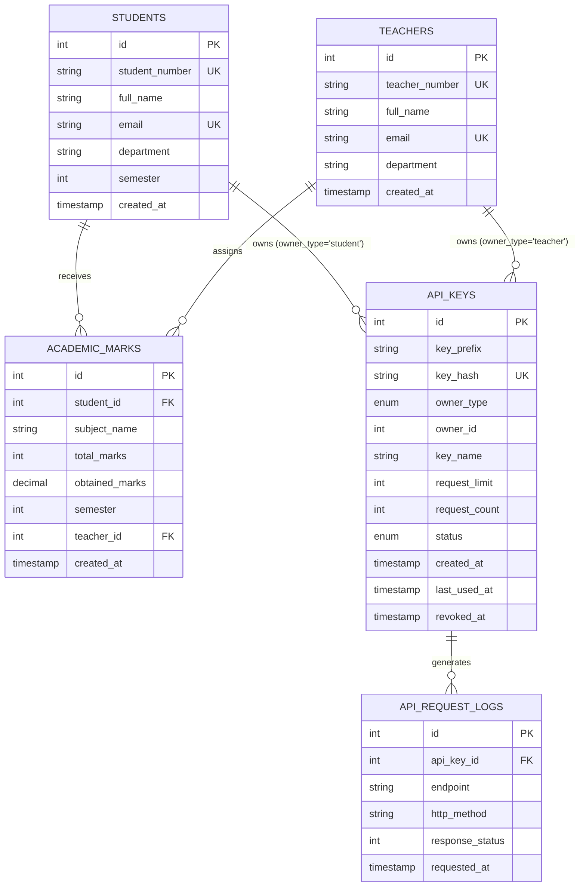
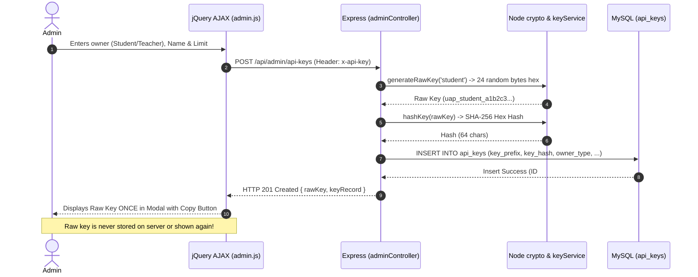

# Full-Stack Web Development Assignment Submission Guide
## Project: University API Access Management System

**Author / Student:** FSD Lab Student  
**Tech Stack:** Node.js, Express.js, MySQL (mysql2), Bootstrap 5, jQuery AJAX  
**Security Architecture:** Header-Based Cryptographic API Key Authentication, SHA-256 Hashing, Role-Based Access Control (RBAC), and Atomic Rate Limiting

---

## 1. Database Schema and Relational Architecture

The relational schema is implemented in MySQL under the database name `university_api_system`.

### Entity-Relationship Diagram (Mermaid)



### Table Definitions & Constraints

1. **`students`**: Stores student academic identity. Indexed on `student_number` (UNIQUE), `department`, and `semester`.
2. **`teachers`**: Stores faculty identity and academic departments. Indexed on `teacher_number` (UNIQUE).
3. **`academic_marks`**: Relates students to faculty teachers through foreign keys with `ON DELETE CASCADE`. Stores subject names, maximum marks, obtained marks, and semester.
4. **`api_keys`**: Stores cryptographic API key metadata. **Plaintext keys are never stored**. Stores SHA-256 `key_hash` (UNIQUE), display `key_prefix`, polymorphic owner pointer (`owner_type`, `owner_id`), `request_limit`, atomic `request_count`, and `status` (`'active'` or `'revoked'`).
5. **`api_request_logs`**: Audit trail recording all incoming requests, foreign-keyed to `api_keys.id` with `ON DELETE SET NULL`.

---

## 2. Main Backend Routes and Middleware Pipeline

### Middleware Pipeline

1. **`authMiddleware.authenticateApiKey`**:
   - Inspects `req.headers['x-api-key']`.
   - Explicitly rejects keys in query strings (`req.query.api_key`) with **HTTP 400**.
   - If missing: returns **HTTP 401**.
   - Hashes raw key with SHA-256 and retrieves record from MySQL.
   - If key not found: returns **HTTP 401**.
   - If `status === 'revoked'`: returns **HTTP 403 Forbidden**.
   - If `request_count >= request_limit`: returns **HTTP 429 Too Many Requests**.
   - Atomically increments `request_count` via parameterized SQL.
   - Attaches `req.auth = { keyId, ownerType, ownerId, keyPrefix, keyName, requestLimit, requestCount, owner }`.
   - Attaches `res.on('finish')` listener to log requests into `api_request_logs`.

2. **`roleMiddleware.requireRole(['admin' | 'teacher' | 'student'])`**:
   - Compares `req.auth.ownerType` against allowed roles.
   - Blocks unauthorized access with **HTTP 403 Forbidden**.

### REST API Route Table

| Route | Method | Middleware | Controller Action |
| :--- | :--- | :--- | :--- |
| `/api/auth/validate` | `POST` | Public | Validates key and returns safe role & owner info |
| `/api/auth/me` | `GET` | `authenticateApiKey` | Returns authenticated identity |
| `/api/admin/stats` | `GET` | `auth` + `requireRole('admin')` | Dashboard metrics & recent logs |
| `/api/admin/students` | `GET` | `auth` + `requireRole('admin')` | Searchable student directory |
| `/api/admin/teachers` | `GET` | `auth` + `requireRole('admin')` | Searchable faculty directory |
| `/api/admin/api-keys` | `GET` | `auth` + `requireRole('admin')` | List managed keys with prefixes |
| `/api/admin/api-keys` | `POST` | `auth` + `requireRole('admin')` | Generate cryptographic API key |
| `/api/admin/api-keys/:id/limit` | `PATCH` | `auth` + `requireRole('admin')` | Update request quota |
| `/api/admin/api-keys/:id/revoke` | `PATCH` | `auth` + `requireRole('admin')` | Revoke key immediately |
| `/api/admin/logs` | `GET` | `auth` + `requireRole('admin')` | Filtered audit request logs |
| `/api/student/profile` | `GET` | `auth` + `requireRole('student')` | Student profile derived from key |
| `/api/student/marks` | `GET` | `auth` + `requireRole('student')` | Student marks derived from key |
| `/api/teacher/profile` | `GET` | `auth` + `requireRole('teacher')` | Teacher profile |
| `/api/teacher/students`| `GET` | `auth` + `requireRole('teacher')` | All students directory |
| `/api/teacher/marks` | `GET` | `auth` + `requireRole('teacher')` | Filterable marks register |

---

## 3. Cryptographic API-Key Generation and Validation Workflow

### Generation Sequence



---

## 4. Student-Versus-Teacher Access Control & Data Isolation

### Critical Security Rule: Key-Derived Identity

In traditional insecure applications, students pass their ID in the request:
`GET /api/student/marks?student_id=5` (Vulnerable to IDOR / tampering).

In our system:
1. The student makes an AJAX request to `GET /api/student/marks` with header `x-api-key`.
2. The server extracts the key, hashes it, and queries MySQL.
3. The server assigns `req.auth.ownerId = key.owner_id`.
4. In `studentController.getMarks`, SQL query is strictly parameterized:
   ```javascript
   SELECT * FROM academic_marks WHERE student_id = ? [req.auth.ownerId]
   ```
5. **Even if a student tampers with query strings, URLs, or local variables, they cannot view another student's marks.**

### Role Boundary Enforcement

- A student key calling `/api/teacher/students` receives **HTTP 403 Forbidden**.
- A teacher key calling `/api/admin/stats` receives **HTTP 403 Forbidden**.
- A student key calling `/api/admin/api-keys` receives **HTTP 403 Forbidden**.

---

## 5. Request-Limit Atomic Enforcement

To prevent concurrency race conditions where multiple rapid requests exceed a quota limit:

```sql
UPDATE api_keys 
SET request_count = request_count + 1, last_used_at = NOW() 
WHERE id = ? AND request_count < request_limit;
```

If `updateResult.affectedRows === 0`, the limit was already reached or surpassed. The server terminates the pipeline immediately and returns:

```json
HTTP/1.1 429 Too Many Requests
{
  "error": "Too Many Requests",
  "message": "API request quota exceeded. Limit: 50, Used: 50",
  "quota": {
    "limit": 50,
    "used": 50,
    "remaining": 0
  }
}
```

---

## 6. HTTP Status Code Handling Summary

| Status Code | Reason in Application | Example Scenario |
| :--- | :--- | :--- |
| **`200 OK`** | Request succeeded | Marks loaded, dashboard stats retrieved |
| **`201 Created`** | Resource created | Cryptographic API key generated |
| **`400 Bad Request`** | Validation failure or security violation | Key in query string, negative request limit |
| **`401 Unauthorized`** | Missing or unrecognized key | No `x-api-key` header, fake key supplied |
| **`403 Forbidden`** | Insufficient permissions or revoked key | Student accessing faculty route, revoked key used |
| **`404 Not Found`** | Resource missing | Student ID does not exist in directory |
| **`429 Too Many Requests`** | Quota exhaustion | Key exceeded configured request limit |
| **`500 Server Error`** | Unhandled server error | Database connection timeout (sanitized message) |

---

## 7. Screenshot Checklist for Assignment PDF

When assembling your submission PDF document, include the following screenshots captured from the running application at `http://localhost:3000`:

1. [ ] **Admin Dashboard Overview (`/admin`):**
   - Shows total students, teachers, active keys, and total requests stat cards.
   - Shows the live Chart.js key distribution doughnut chart.
2. [ ] **Managed API Keys Table (`/admin` -> API Keys tab):**
   - Shows list of keys with prefixes (`uap_student_...`), owner names, progress bars, and active badges.
3. [ ] **API Key Generation Modal & Single Reveal:**
   - Modal filled with Student name and 150 request limit.
   - The green success modal displaying the newly generated cryptographic key with the Copy button.
4. [ ] **Request Limit Update & Revocation Modals:**
   - The Update Limit dialog modifying quota to 500.
   - The Revocation Confirmation modal with warning text.
5. [ ] **API Request Audit Logs (`/admin` -> Audit Request Logs tab):**
   - Table showing timestamped requests, endpoints, HTTP methods, and color-coded status badges (200, 401, 403, 429).
6. [ ] **Key Settings & Validation (`/settings`):**
   - Inputting key, clicking Validate, and seeing the connected identity card with quota allocation.
7. [ ] **Student Dashboard (`/student/dashboard`):**
   - Verified student profile (Zainab Ahmed).
   - Academic marks table with subjects, obtained marks, percentage, and teacher names.
   - The subject performance comparison bar chart.
8. [ ] **Teacher Faculty Dashboard (`/teacher/dashboard`):**
   - Dr. Alan Turing's dashboard displaying marks across multiple students and departments.
   - Using the department and semester dropdown filters.
9. [ ] **Security Test 1: Student Denied Faculty Access (HTTP 403):**
   - Browser console / network tab showing `GET /api/teacher/students` returning HTTP 403 Forbidden for a student key.
10. [ ] **Security Test 2: Quota Exceeded Response (HTTP 429):**
    - Click "Simulate Exceeded Quota Request" on the home page or settings, showing the HTTP 429 toast and JSON response.
11. [ ] **Security Test 3: Revoked Key Rejection (HTTP 403):**
    - Click "Simulate Revoked Request", showing the HTTP 403 toast and revoked timestamp.
12. [ ] **Automated Test Results:**
    - Terminal screenshot showing `npm test` passing all 27 tests with green checkmarks.

---

## 8. Short Demo Video Script (2–3 Minutes)

Use this script during your presentation or video recording:

- **0:00 – 0:30 | Introduction & Tech Stack:**
  > *"Hello, this is the University API Access Management System built for the Full Stack Development lab. The backend is built using Node.js and Express with MySQL2 database pooling. The frontend uses Bootstrap 5 and jQuery AJAX. Authentication is strictly tokenless and header-based via the `x-api-key` HTTP request header."*
- **0:30 – 1:00 | Admin Dashboard & Key Lifecycle:**
  > *"Starting in the Admin Console, we see live system statistics and recent activity. In the API Keys tab, we can view all active and revoked keys. Plaintext keys are never stored—only SHA-256 hashes. Let's generate a new key for student Ayesha Khan with a quota of 250 requests. The system returns the raw key once, allowing us to copy it."*
- **1:00 – 1:30 | Settings & Student Data Isolation:**
  > *"Now we go to `/settings` and connect with Zainab Ahmed's student key. The server validates the key and updates our session. In the Student Dashboard, Zainab can view only her own profile and academic marks. Notice that the frontend never sends Zainab's student ID—the backend derives her identity exclusively from the key hash in the header. If we try to tamper with identifiers, our access remains strictly isolated."*
- **1:30 – 2:00 | Faculty Oversight:**
  > *"Next, switching to Dr. Alan Turing's faculty key, we access the Teacher Portal. Dr. Turing can inspect marks across all departments and filter by semester and subject, with calculated averages. However, notice that faculty keys are read-only and cannot perform administrative tasks."*
- **2:00 – 2:30 | Rate Limiting (429) & Revocation (403):**
  > *"Finally, we demonstrate quota enforcement and key revocation. In the home portal, testing our rate-limited key immediately triggers HTTP 429 Too Many Requests, showing that our atomic SQL counter protects against quota overrun. Testing our revoked key immediately returns HTTP 403 Forbidden. All these events are tracked live in the admin request audit log."*

---

## 9. Key Code Excerpts for Assignment Report

### Excerpt 1: Atomic Rate Limit & Authentication (`middleware/authMiddleware.js`)
```javascript
// Check Request Quota
if (keyData.request_count >= keyData.request_limit) {
  return res.status(429).json({
    error: 'Too Many Requests',
    message: `API request quota exceeded. Limit: ${keyData.request_limit}, Used: ${keyData.request_count}`
  });
}

// Concurrency-safe atomic increment
const [updateResult] = await pool.execute(
  `UPDATE api_keys 
   SET request_count = request_count + 1, last_used_at = NOW() 
   WHERE id = ? AND request_count < request_limit`,
  [keyData.id]
];

if (updateResult.affectedRows === 0) {
  return res.status(429).json({ error: 'Too Many Requests', message: 'Quota exceeded.' });
}
```

### Excerpt 2: Key-Derived Student Data Isolation (`controllers/studentController.js`)
```javascript
// Student identity is derived SOLELY from req.auth.ownerId (extracted from key hash)
const studentId = req.auth.ownerId;

const [marks] = await pool.execute(
  `SELECT m.id, m.subject_name, m.total_marks, m.obtained_marks, m.semester,
          t.full_name AS teacher_name
   FROM academic_marks m
   JOIN teachers t ON m.teacher_id = t.id
   WHERE m.student_id = ?
   ORDER BY m.semester ASC, m.subject_name ASC`,
  [studentId]
);
```

### Excerpt 3: jQuery AJAX Reusable Header Injection (`public/js/api-client.js`)
```javascript
function request(options) {
  const key = getKey();
  const headers = options.headers || {};

  if (key) {
    headers['x-api-key'] = key; // Attach key to request header
  }

  return $.ajax({
    url: options.url,
    method: options.method || 'GET',
    headers: headers,
    contentType: 'application/json; charset=utf-8',
    data: options.data && options.method !== 'GET' ? JSON.stringify(options.data) : options.data,
    dataType: 'json'
  });
}
```
